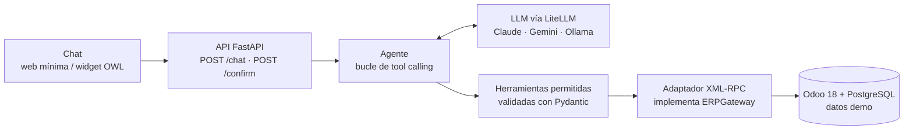

# SPEC: Asistente de IA para Odoo

Agente de IA que responde preguntas de negocio en lenguaje natural consultando un Odoo 18 real, y que ejecuta acciones seguras con confirmación humana. Es un proyecto de portafolio: combina Odoo, Python, FastAPI, LLMs y agentes, con arquitectura limpia, pruebas y evals.

Este documento es la fuente de verdad del proyecto. Si el código y la spec no coinciden, se corrige el código o se actualiza la spec de forma explícita.

## 1. Casos de uso del MVP

El MVP se limita a ventas, inventario y facturación sobre una base de Odoo con **datos de demostración**.

| Pregunta o acción del usuario | Qué hace el agente |
| --- | --- |
| "¿Cuánto vendimos este mes y cómo va contra el mes pasado?" | Agrega pedidos confirmados de los dos períodos y calcula la variación |
| "¿Quiénes son los 5 clientes que más compran?" | Agrupa ventas por cliente y ordena |
| "¿Qué productos están por debajo del stock mínimo?" | Cruza existencias con reglas de reabastecimiento |
| "¿Qué facturas de Acme Corporation están vencidas?" | Busca el cliente, filtra facturas vencidas y suma el saldo |
| "Resúmeme el pedido S00023" | Lee el pedido y sus líneas y lo explica |
| "Crea un presupuesto para Azure Interior con 10 sillas de oficina" | Prepara el borrador, lo muestra y **pide confirmación** antes de crearlo |

## 2. Arquitectura



Principios:

- **El LLM nunca habla con Odoo directamente.** Decide qué herramienta usar; el código valida los argumentos y ejecuta la herramienta a través del puerto `ERPGateway`.
- **Arquitectura hexagonal.** `app/domain/` no importa nada externo (ni `xmlrpc`, ni `litellm`, ni `fastapi`). Define los puertos `ERPGateway` y `LLMClient` como `typing.Protocol`. Los adaptadores viven en `app/adapters/`.
- **Escritura en dos pasos.** El agente solo puede *preparar* un presupuesto. Lo crea el endpoint `POST /confirm` cuando el usuario aprueba. El LLM no tiene acceso a `create_quotation`.

## 3. Stack técnico

| Pieza | Elección |
| --- | --- |
| ERP | Odoo 18 Community con datos de demostración (módulos `sale_management`, `stock`, `account`) |
| Lenguaje | Python 3.12, con type hints en todo el código |
| API | FastAPI + Pydantic v2 |
| LLM | LiteLLM; el modelo se elige con `LLM_MODEL` y la clave del proveedor con `LLM_API_KEY`. Por defecto, Gemini |
| Agente | Bucle propio de tool calling, sin frameworks de agentes |
| Acceso a Odoo | API externa XML-RPC (`xmlrpc.client` de la librería estándar): `/xmlrpc/2/common` para autenticar, `/xmlrpc/2/object` con `execute_kw` |
| Pruebas | pytest; marcadores `integration` y `evals` |
| Calidad | ruff (lint y formato), mypy, GitHub Actions |
| Entorno | Docker Compose: `odoo`, `db` (PostgreSQL 16) y `api` |
| Paquetes | `uv` |

## 4. Herramientas del agente

Cada herramienta es una operación de negocio con parámetros validados por un modelo Pydantic. No existe ninguna herramienta genérica del tipo "ejecuta cualquier método de Odoo".

| Herramienta | Parámetros | Devuelve | Modelos de Odoo | Tipo |
| --- | --- | --- | --- | --- |
| `search_partners` | `name: str`, `limit: int = 5` (máx. 20) | id, nombre, email, ciudad | `res.partner` | Lectura |
| `search_products` | `name: str`, `limit: int = 5` (máx. 20) | id, nombre, referencia, precio de venta, unidad; busca por nombre o referencia entre los productos vendibles | `product.product` | Lectura |
| `sales_summary` | `date_from: date`, `date_to: date`, `group_by: Literal["none", "partner", "product"] = "none"`, `limit: int = 10` | total sin impuestos y número de pedidos, global o por grupo, en moneda de la compañía; fechas en días UTC con fin inclusivo | `sale.order` (estado `sale`), `read_group`; por producto, `sale.order.line` con pedidos distintos (`order_id:count_distinct`) | Lectura |
| `low_stock_products` | `limit: int = 20` (máx. 50) | producto, stock disponible (`qty_on_hand`), stock previsto (informativo) y mínimo de la regla; solo reglas con disponible < mínimo, ordenadas por déficit. El filtro se hace en Python porque `qty_on_hand` no está almacenado | `stock.warehouse.orderpoint` | Lectura |
| `overdue_invoices` | `partner_id: int \| None = None` | número, cliente (entidad comercial), fecha de vencimiento, saldo pendiente y total, más el número de facturas y la suma de saldos; vencida = fecha de vencimiento anterior a hoy (UTC); el filtro por cliente incluye sus contactos (`child_of`) | `account.move` (`out_invoice`, `posted`, `payment_state` `not_paid` o `partial`) | Lectura |
| `get_sale_order` | `name: str` (ej. `S00023`, sin distinguir mayúsculas) | cabecera y líneas de producto del pedido (sin secciones ni notas) | `sale.order`, `sale.order.line` | Lectura |
| `prepare_quotation` | `partner_id: int`, `lines: list[{product_id: int, quantity: float > 0}]` (1 a 50 líneas) | `draft_id`, resumen legible y total estimado sin impuestos (cantidad × precio de tarifa); valida que el cliente exista y que los productos existan y se puedan vender; **no escribe en Odoo** | Solo lectura (`res.partner`, `product.product`) | Preparación |
| `create_quotation` | `draft_id: str` | id, nombre y totales del presupuesto creado; Odoo calcula precios e impuestos | `sale.order` (`create` y `message_post`) | Escritura: **solo desde `POST /confirm`, nunca disponible para el LLM** |

Los borradores se guardan en memoria del proceso (un diccionario con caducidad, `DRAFT_TTL_SECONDS`, 900 por defecto) en el MVP. Un borrador caducado, desconocido o ya confirmado devuelve un error claro. Confirmar consume el borrador, así que un doble clic no crea dos presupuestos; si Odoo falla, el borrador se conserva para reintentar.

## 5. API

| Endpoint | Entrada | Salida |
| --- | --- | --- |
| `POST /chat` | `{"message": str, "conversation_id": str \| null}` | `{"conversation_id": str, "answer": str, "pending_draft": {...} \| null, "tool_calls": [...]}` |
| `POST /confirm` | `{"draft_id": str, "confirmed_by_user_id": int \| null}` | `{"quotation_id": int, "name": str, "amount_untaxed": float, "amount_total": float}`; 404 si el borrador no existe, caducó o ya se confirmó; 502 si Odoo lo rechaza; 503 si Odoo no responde |
| `GET /health` | | `{"status": "ok", "odoo": "ok" \| "unreachable"}` |
| `GET /` | | Chat web mínimo (HTML) |

`tool_calls` en la respuesta lista las herramientas usadas con sus argumentos (`[{"name": str, "arguments": {...}}]`), para mostrar en la interfaz qué hizo el agente. El historial de cada `conversation_id` se guarda en memoria del proceso y caduca tras `CONVERSATION_TTL_SECONDS` sin actividad. Si el modelo falla, `POST /chat` responde 503. Si `API_TOKEN` está definido, `POST /chat` y `POST /confirm` exigen la cabecera `Authorization: Bearer <API_TOKEN>` y responden 401 sin ella; `GET /health` sigue abierto para la monitorización, y la web de `GET /` pide el token cuando recibe un 401. `confirmed_by_user_id` es el id del usuario de Odoo que pulsó Confirmar (lo envía el módulo de Odoo); solo se registra el id. `pending_draft` es el último borrador preparado en el turno: `{"draft_id", "partner_id", "partner_name", "lines": [{"product_id", "product_name", "quantity", "price_unit", "subtotal"}], "estimated_total_untaxed"}`.

## 6. Seguridad y guardarraíles

- **Permisos mínimos:** el agente usa un usuario técnico de Odoo que solo lee ventas, inventario y facturas, y solo puede crear presupuestos. Se autentica con una **API key de Odoo** en `.env`. Nunca hay credenciales en el código ni en el repositorio. En el MVP se usan grupos estándar (`Ventas: todos los documentos`, `Inventario: usuario`, `Contabilidad: solo lectura`), que aún permiten algunas escrituras; restringirlo del todo exigiría reglas de acceso propias (limitación conocida).
- **Validación:** Pydantic valida cada llamada antes de tocar Odoo. Los argumentos inválidos vuelven al LLM como un error de herramienta legible, sin lanzar excepciones al usuario.
- **Prompt injection:** los textos que vienen de Odoo (notas, descripciones, nombres) se pasan al modelo como datos dentro de etiquetas `<odoo_data>`. El system prompt indica que nunca siga instrucciones que aparezcan ahí.
- **Límites del bucle:** `AGENT_MAX_ITERATIONS` (por defecto 6) y `AGENT_TIMEOUT_SECONDS` (por defecto 60).
- **Auditoría:** cada llamada a una herramienta se registra en el logger `app.audit` (una línea JSON por evento) con conversación, herramienta, argumentos, resultado y duración, sin datos personales: los ids, números y booleanos se registran tal cual y los textos libres se sustituyen por su longitud. Cada confirmación registra el borrador, el cliente (id), el presupuesto creado, el resultado y, si se conoce, el usuario de Odoo que confirmó (`confirmed_by_user_id`). El presupuesto creado lleva una nota interna en el chatter: "Creado por el asistente de IA tras confirmación del usuario", seguida de `#<id>` del usuario de Odoo cuando se conoce; para publicarla, el usuario técnico necesita un email (`ai-assistant@example.com`).
- **Acceso a la API:** con `API_TOKEN` definido, solo quien tiene el token puede chatear o confirmar.
- **Datos:** solo la base de demostración. Nunca datos reales en el repositorio, las pruebas ni las evals.

## 7. Calidad

| Nivel | Qué prueba | Cómo |
| --- | --- | --- |
| Unitarias | Dominio, validación de herramientas y flujo de confirmación en dos pasos | `FakeERP` en memoria, TDD |
| Bucle del agente | Herramienta correcta, límite de iteraciones y manejo de errores | `FakeLLM` con respuestas guionadas |
| Integración | Que el adaptador XML-RPC traduzca bien los datos reales | Odoo en Docker, `pytest -m integration` |
| Evals | Corrección de punta a punta | `tests/evals/cases.yaml`: pregunta, herramientas esperadas y prohibidas, y respuesta esperada. Las cifras no se escriben a mano: cada expectativa nombra un *hecho* que se calcula en vivo desde Odoo, porque los datos demo dependen de la fecha de instalación. La corrección es determinista (sin LLM como juez) y todo caso comprueba además que no se creó ningún pedido. `pytest -m evals` compara los modelos de `EVAL_MODELS` (por defecto `LLM_MODEL`), respeta la cuota con `EVAL_REQUESTS_PER_MINUTE` y genera en `tests/evals/reports/` (sin versionar) un informe con el porcentaje de aciertos (total y por categoría), la latencia media y p95, los tokens y el costo estimado por modelo. El informe de referencia se versiona en `docs/evals-report.md` |

En CI (GitHub Actions, en cada push y pull request; `.github/workflows/ci.yml`): `ruff check`, `ruff format --check`, `mypy app` y `pytest -m "not integration and not evals"`.

Cada respuesta del modelo trae su uso (tokens de entrada y salida, y costo estimado con la lista de precios pública de LiteLLM, vacío si el modelo no tiene precio). El agente suma el uso del turno y lo registra en el log, sin texto de la conversación.

## 8. Estructura del repositorio

```text
odoo-ai-assistant/
├── app/
│   ├── domain/              # entidades y puertos, sin dependencias externas
│   │   ├── models.py
│   │   └── ports.py
│   ├── agent/
│   │   ├── loop.py          # bucle de tool calling
│   │   ├── tools.py         # definición, validación y despacho
│   │   ├── conversations.py # historial de conversaciones en memoria con caducidad
│   │   ├── drafts.py        # almacén de borradores con caducidad
│   │   ├── audit.py         # registro de auditoría sin datos personales
│   │   └── prompts.py       # system prompt versionado
│   ├── adapters/
│   │   ├── odoo_xmlrpc.py
│   │   ├── litellm_client.py
│   │   ├── rate_limited_llm.py  # limita peticiones por minuto (cuotas de los planes gratuitos)
│   │   ├── fake_erp.py
│   │   └── fake_llm.py      # respuestas guionadas para pruebas
│   ├── api/routes.py
│   ├── web/index.html       # chat mínimo servido en GET /
│   ├── config.py            # pydantic-settings, lee .env
│   ├── logging_config.py    # logs de la app (y auditoría) a nivel INFO
│   └── main.py
├── odoo_addons/
│   └── ai_assistant_chat/   # fase 5: chat OWL en la barra superior de Odoo
├── scripts/
│   ├── init_odoo.sh         # crea la base demo y el usuario técnico
│   └── odoo_create_tech_user.py  # se ejecuta dentro de `odoo shell`
├── tests/
│   ├── contract/            # contrato de ERPGateway (FakeERP y Odoo)
│   ├── unit/
│   ├── odoo_rpc.py          # XML-RPC directo para inspeccionar y limpiar Odoo en pruebas
│   ├── integration/
│   └── evals/
│       ├── cases.yaml       # catálogo de casos
│       ├── cases.py         # esquema y carga del catálogo
│       ├── facts.py         # valores esperados, calculados en vivo desde Odoo
│       ├── checks.py        # corrección determinista de cada respuesta
│       ├── runner.py        # ejecuta un caso contra el agente real
│       └── report.py        # informe comparativo por modelo
├── docs/
│   └── evals-report.md      # informe de evals de referencia
├── .github/workflows/ci.yml
├── Dockerfile               # imagen de la API
├── docker-compose.yml
├── pyproject.toml
├── .env.example
├── CLAUDE.md
├── SPEC.md
└── README.md
```

## 9. Plan por fases y criterios de aceptación

Cada fase termina con algo que funciona. **No se empieza una fase hasta cerrar la anterior.**

### Fase 1: Base

- `docker compose up -d` levanta Odoo 18, PostgreSQL y la API.
- `scripts/init_odoo.sh` crea la base `demo` con `sale_management`, `stock` y `account` y sus datos de demostración, y crea el usuario técnico con su API key.
- `ERPGateway` definido en `app/domain/ports.py`.
- Adaptador XML-RPC con `search_partners` y `sales_summary`, con pruebas unitarias (contra `FakeERP`) y de integración (contra Odoo).
- `GET /health` responde y comprueba la conexión con Odoo.

### Fase 2: Agente de consulta

- `LLMClient` con su adaptador LiteLLM y un `FakeLLM` para pruebas.
- Bucle de tool calling con límite de iteraciones y timeout.
- Las seis herramientas de lectura implementadas y probadas.
- `POST /chat` funcionando, con una web mínima (un HTML servido por FastAPI) para conversar.
- Las cinco preguntas de lectura del MVP responden correctamente con los datos demo.

### Fase 3: Acción con confirmación

- `prepare_quotation` y el almacén de borradores con caducidad.
- `POST /confirm` crea el presupuesto y deja el mensaje en el chatter.
- Pruebas: el LLM no puede crear un presupuesto sin confirmación; un borrador caducado devuelve error.
- Registro de auditoría de herramientas.

### Fase 4: Calidad

- Al menos 20 casos en `tests/evals/cases.yaml`.
- Informe de evals comparando al menos dos modelos.
- GitHub Actions en verde.

### Fase 5: Dentro de Odoo

- Módulo `ai_assistant_chat` (Odoo 18, `version` del manifest `18.0.1.0.0`, licencia LGPL-3).
- Componente OWL en la barra superior que abre un panel de chat y llama a la API.
- La URL de la API se configura en Ajustes, como parámetro del sistema.

### Fase 6: Presentación

- README en este orden: problema en una frase, GIF de la demo, diagrama, cómo levantarlo, decisiones de diseño, resultados de las evals y limitaciones conocidas.
- Licencias: MIT para la API, LGPL-3 para el módulo de Odoo.
